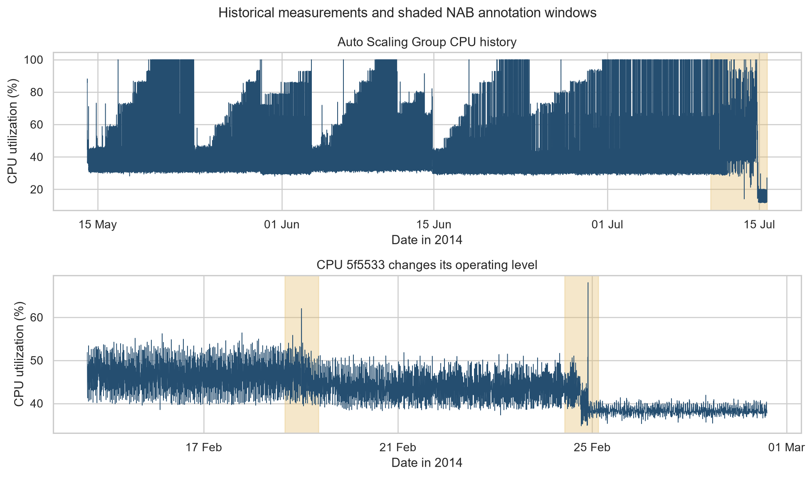
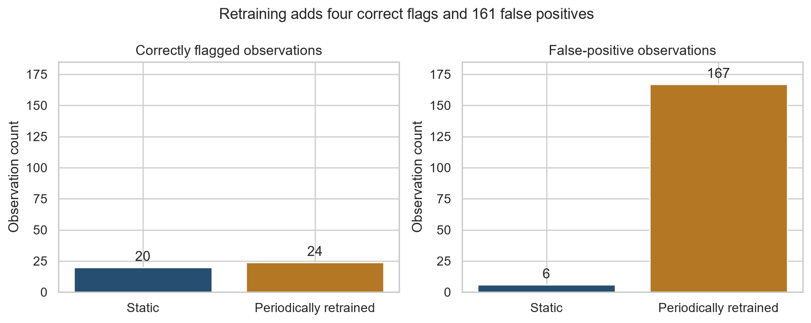
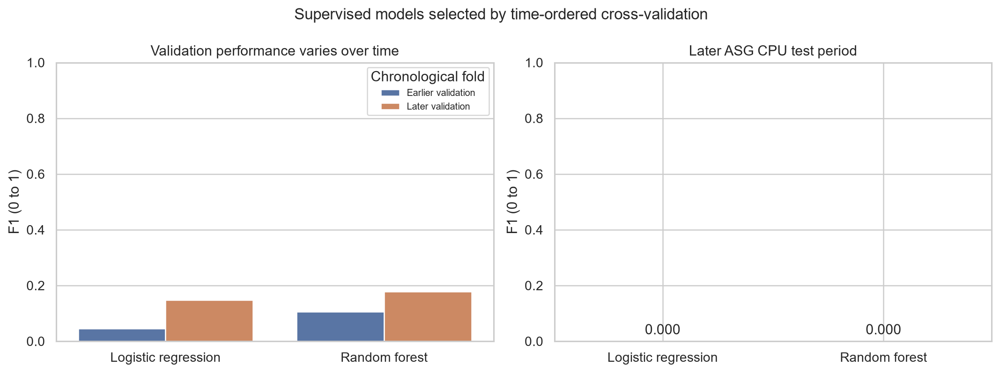

# SaaS anomaly detection with machine learning

**UC Berkeley AI/ML Capstone — final nontechnical report**

Can machine learning help an operations team notice unusual service behavior without overwhelming it with false alarms? The experiments show improvements in selected failure scenarios, but changing workloads and periodic retraining expose serious weaknesses. A supervised extension also misses the later ASG anomalies despite cross-validation and parameter tuning.

**Recommendation:** retain a statistical reference, assess each workload, and require evidence and human review before deploying or updating a detector. These results support further testing, not unattended production use.

**OpenTelemetry was not deployed.** This is an offline study of downloaded historical metrics. Live metrics/logs/traces, incident correlation, AI-generated explanations and remediation remain proposed extensions.

## Capstone milestone submissions

| Part and module | Submission artifact |
|---|---|
| Part 1 — Module 11 prospectus | [Problem statement and prospectus](milestones/module_11_prospectus.md) |
| Part 1 — Assignment 16.1 | [Formal proposal: question, data, expected results and techniques](milestones/module_16_proposal.md) |
| Part 1 — Assignment 20.1 | [Self-contained initial report and EDA notebook](notebooks/20_initial_report_and_eda.ipynb) |
| Part 2 — Module 24 | This final README and the technical notebooks below |

Part 1 artifacts consolidate the completed project for milestone submission. Expected outcomes in the proposal are distinguished from measured results. No earlier submission, grade or program-leader meeting is claimed. Each assignment must still be submitted in its own course entry.

## Read the analysis

| Notebook | Purpose |
|---|---|
| [01 — Explore telemetry](notebooks/01_telemetry_eda.ipynb) | Data checks, distributions, time-series plots and historical features |
| [02 — Compare anomaly detectors](notebooks/02_anomaly_detection.ipynb) | Statistical baseline, Isolation Forest, metric verification and workload shift |
| [05 — Test periodic retraining](notebooks/05_drift_aware_detection.ipynb) | Static versus retrained models on three additional series |
| [06 — Validate supervised models](notebooks/06_model_validation.ipynb) | Logistic regression and random forest, chronological cross-validation and grid search |

Numbers retain their original project references. Empty exploratory placeholders are excluded. Optional companions: [editable Word report](reports/UC_Berkeley_AIOps_Final_Report.docx) and [PDF report](reports/UC_Berkeley_AIOps_Final_Report.pdf). This README is the primary nontechnical submission.

## 1. Define the Problem Statement

SaaS operations teams must recognize service degradation without being overwhelmed by unnecessary investigations. Missed warnings delay action; repeated false alarms undermine trust. This project asks whether machine learning improves anomaly detection over a simple statistical rule, and whether learning recent behavior helps when workloads change.

The study evaluates detection coverage and false alarms. It does not measure downtime reduction, recovery time, cost savings, customer impact or incident root causes.

## 2. Model Outcomes or Predictions

The initial models classify each observation as normal or potentially anomalous. Isolation Forest is **unsupervised**: it learns patterns without anomaly labels, which are used afterward for evaluation. Its score measures unusualness, not outage probability.

The supplementary experiment uses **supervised classification**: logistic regression and random forest learn from earlier annotation-window labels. These predict window membership, not verified incidents. They are evaluated separately because their training and splits differ from the original study.

None of the experiments forecasts an outage in advance. A flagged observation is a candidate for investigation, not a confirmed failure or remediation instruction.

## 3. Data Acquisition

Eight series come from the [Numenta Anomaly Benchmark](https://github.com/numenta/NAB): six from `realAWSCloudwatch` and two from `realKnownCause`. CPU utilization, latency, network traffic and request counts represent different aspects of service health. The **46,274 raw observations** span February–July 2014. These are multiple series from one benchmark, not independent data providers.

Files contain timestamps and numeric measurements; separate annotations provide unusual-event windows. There are no linked deployment records, service logs or customer-impact measurements.

| Original experiment and series | Raw rows | Test rows after preparation |
|---|---:|---:|
| Initial: CPU 5f5533, 24ae8d, 53ea38 | 12,096 | 2,412 |
| Initial: request latency failure | 4,032 | 802 |
| Initial: Auto Scaling Group CPU | 18,050 | 3,608 |
| Retraining: CPU 825cc2, network-in 257a54, request-count 8c0756 | 12,096 | 2,412 |



The plots illustrate recurring CPU behavior and changing operating levels. Shading indicates NAB annotation windows, **not verified incident durations**. These patterns provide useful test cases but do not establish the causes of changes.

## 4. Data Preprocessing/Preparation

Timestamps and values were converted to consistent types, sorted chronologically and checked for missing entries and repeated timestamps. There were no missing timestamp/value entries in the source files. Eleven duplicate timestamps were removed from the latency data.

The modeling experiments summarize the preceding 12 readings through their average, variability and change. The initial comparison and supervised extension also use lagged values. Historical averages exclude the current reading. Dropping the first 12 readings of each cleaned series leaves **46,167 usable observations**. The exploratory notebook also demonstrates current-inclusive trailing features; modeling notebooks rebuild their stricter historical features from raw data.

Original experiments split each series chronologically: 60% training, 20% reserved validation and 20% testing. No rows are shuffled. Scaling uses only the relevant training/reference history. The reserved validation periods did **not** select the original settings. Retraining uses only observations before each new block, including earlier test observations without their labels.

The supervised extension instead pools all series in global calendar order and reserves the latest approximately 20% for testing. Training never uses later-calendar data from another series to predict earlier observations. A one-hour boundary gap leaves **36,921 development observations and 9,234 test observations**; 12 boundary readings are excluded. Scaling and series-category encoding are fitted within each training fold. This is a different evaluation from the original per-series splits.

## 5. Modeling

| Approach | Rationale and settings |
|---|---|
| Statistical Z-score | Explainable reference; flag readings more than three recent standard deviations from the historical average |
| Initial Isolation Forest | Detect unusual feature combinations; six features, 200 trees; threshold at the 98th percentile of training scores |
| Static versus retrained Isolation Forest | Separate three-series study; four features, 100 trees; static fits once, retrained fits every 48 readings using 288 earlier readings |
| Logistic regression | Simple supervised linear classifier; six combinations of regularization strength and class weighting |
| Random forest classifier | Supervised nonlinear comparison; four combinations of tree depth and minimum leaf size, with 100 trees |

### Chronological cross-validation and grid search

The supervised extension has two expanding validation folds. Fold 1 trains on the earliest quarter of development observations and validates on the next quarter. Fold 2 trains on the earliest half and validates on the next quarter. The remaining development observations are available for refitting. Training precedes validation by at least one hour. Both folds contain both label classes; their calendar durations and series mixes differ.

The logistic grid tests `C` values 0.1, 1 and 10 with either no class weighting or balanced weights. The forest grid tests maximum depths 4 and 8 and minimum leaf sizes 5 and 20, with balanced weights fixed. There are **10 configurations and 20 validation fits**, followed by one refit per model family. Pipelines fit preprocessing inside each fold.

Mean validation **F1** selects settings and the model family. The classification threshold is fixed at 0.5, with no later-test tuning. Random forest selects depth 8 and minimum leaf size 5; logistic regression selects `C=0.1` and balanced weights. [Selection results](reports/results/model_selection.csv) · [Full grid](reports/results/grid_search_results.csv) · [Fold boundaries](reports/results/folds.csv)

## 6. Model Evaluation

### What the metrics mean

- **Precision:** Among flagged readings, the proportion inside annotation windows.
- **Recall:** Among window-labeled readings, the proportion flagged.
- **F1:** A balance of precision and recall, from 0 to 1. Used for supervised selection because both false alarms and misses matter.
- **False-positive rate:** The proportion of normal-labeled readings incorrectly flagged.

Accuracy alone can reward a model that always predicts normal. F1 cannot establish an acceptable paging workload either; recall and false-positive counts remain important. No confidence intervals or significance claims are made from the small number of events and correlated observations.

Every reading inside a window is treated as positive. These are pointwise comparisons, **not official NAB scores**. Counts represent observations, not distinct incidents or pages sent to staff.

### Finding 1 — Machine learning helps in selected scenarios

| Series and method | Precision | Recall | F1 | False positives |
|---|---:|---:|---:|---:|
| ASG CPU — statistical | 43.66% | 2.07% | 0.0395 | 40 |
| ASG CPU — Isolation Forest | 74.75% | 55.30% | 0.6357 | 280 |
| Latency — statistical | 33.33% | 2.37% | 0.0442 | 10 |
| Latency — Isolation Forest | 67.31% | 16.59% | 0.2662 | 17 |
| CPU 24ae8d — statistical | 53.33% | 3.98% | 0.0741 | 14 |
| CPU 24ae8d — Isolation Forest | 53.85% | 3.48% | 0.0654 | 12 |

On ASG CPU, Isolation Forest detected 829 of 1,499 labeled readings versus 31 for the rule, but missed 670. Latency detection improved from 5 to 35 of 211. On CPU 24ae8d, Isolation Forest detected 14 of 402 versus 16 for the rule. [All initial per-series results](reports/results/initial_per_series.csv)

**Action:** assess each workload separately; do not select a detector from its best example alone.

### Finding 2 — Changing normal behavior can overwhelm a detector

CPU 5f5533 changed from a training mean of 45.17 to a test mean of 38.27, with standard deviation falling from 3.67 to 0.98. Isolation Forest flagged **all 804 normal-labeled test readings**, a 100% false-positive rate. The statistical rule flagged five, or 0.62%.

CPU 53ea38 also had no labeled test anomalies: Isolation Forest generated seven false positives versus 12 for the rule. Recall cannot be estimated in these anomaly-free periods. The observed distribution shift does not establish its operational cause.

**Action:** monitor workload and score distributions and investigate changes before recalibrating.

### Finding 3 — Periodic retraining increased noise

| Measure | Static Isolation Forest | Periodically retrained |
|---|---:|---:|
| Correctly flagged readings | 20 | 24 |
| False-positive readings | 6 | 167 |
| Missed labeled readings | 181 | 177 |
| Correctly unflagged readings | 2,205 | 2,044 |
| Precision | 76.92% | 12.57% |
| Recall | 9.95% | 11.94% |
| F1 | 0.1762 | 0.1224 |
| False-positive rate | 0.27% | 7.55% |



The same 2,412 test readings include 201 positive labels. Retraining adds four correct flags and 161 false positives. Both models detect the only overlapping annotation window; one window cannot establish reliable event detection. [Results](reports/results/retraining_comparison.csv)

**Action:** prefer the static model for this noise-sensitive comparison, while recognizing that its low recall makes it unsuitable as the sole detector. Review candidate updates and retain rollback.

### Finding 4 — Validation did not ensure later detection

| Model | Earlier-fold F1 | Later-fold F1 | Mean validation F1 | Final-test recall | Final-test F1 |
|---|---:|---:|---:|---:|---:|
| Logistic regression | 0.0449 | 0.1480 | 0.0964 | 0% | 0 |
| Random forest | 0.1060 | 0.1776 | 0.1418 | 0% | 0 |



Random forest was selected before test evaluation. Both models made **zero positive predictions** on the 9,234 later ASG readings: they missed all 1,499 positive labels and correctly left 7,735 normal-labeled readings unflagged. Precision is undefined because neither predicted a positive. Zero false alarms does not establish useful detection. [Test results](reports/results/supervised_test_metrics.csv)

The global test period contains only ASG CPU, whose anomalies occur outside supervised training. The extension reuses previously inspected data: its test is held out from this grid search, but is not a new external benchmark. Two validation folds provide limited evidence about stability.

**Action:** collect incident-reviewed labels across additional workloads and test transfer before deployment. Retain the failed result rather than tune against its test labels.

### Limitations and next steps

The original study is exploratory, includes four anomaly-free test periods, and has only one event window in its retraining evaluation. The supervised extension has changing series composition and a single-series final period. An untouched external evaluation, repeated-seed robustness, more independent events and measured business outcomes remain absent. Annotation windows are imperfect operational truth.

Before a live pilot:

1. Agree on acceptable grouped false-alert volume, detection coverage and detection delay.
2. Test unseen workloads with confirmed incidents and preserve an untouched final evaluation.
3. Compare candidate model updates with existing monitoring; require review and rollback.
4. Pilot alongside existing monitoring and measure investigations and missed incidents.
5. Consider OpenTelemetry collection and metric/log/trace context as future integration work, not completed results.

## Reproduce the analysis

Tested with Python 3.13.14 and the pinned package versions in requirements.txt. Other Python versions were not verified. In PowerShell:

```powershell
git clone https://github.com/rvmkrishna/saas-aiops-observability.git
cd saas-aiops-observability
py -m venv .venv
.\.venv\Scripts\python.exe -m pip install -r requirements.txt
.\.venv\Scripts\python.exe scripts\download_data.py
.\.venv\Scripts\python.exe -m jupyter notebook
```

Run all notebook cells in order **01 → 02 → 05 → 06**, then:

```powershell
.\.venv\Scripts\python.exe scripts\verify_results.py
.\.venv\Scripts\python.exe scripts\build_report_figures.py
```

Raw files and observation-level outputs are generated under `data/` and excluded from Git. Small result tables, figures and executed notebooks are included for review. [Verification record](reports/verification.txt) · [Tested environment](reports/environment.txt)

All four primary notebooks and the standalone Module 20 notebook were executed from fresh kernels on 22 November 2026. Independent checks matched predictions to local raw values and annotations, recalculated metrics, checked original time splits and verified the supervised selection. Original results were preserved. These checks do not establish upstream source authenticity or remove retrospective bias.

## Sources

- [Numenta Anomaly Benchmark](https://github.com/numenta/NAB)
- [Scikit-learn Isolation Forest](https://scikit-learn.org/stable/modules/generated/sklearn.ensemble.IsolationForest.html)
- [Scikit-learn GridSearchCV](https://scikit-learn.org/stable/modules/generated/sklearn.model_selection.GridSearchCV.html)
- Berkeley Module 24 instructions, six-section report template and grading rubric supplied with the project.
